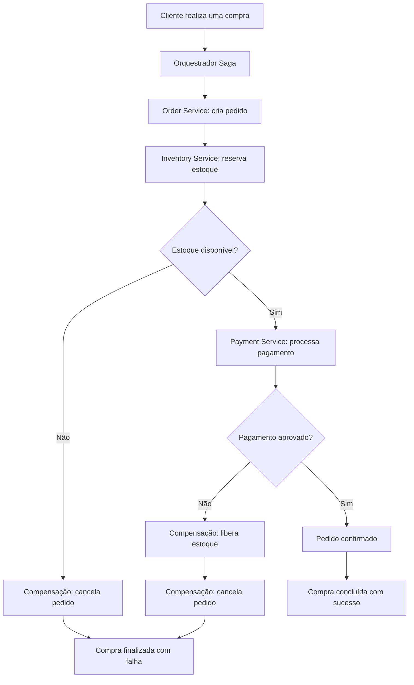

# Fluxo da Transação Saga — E-commerce

## Objetivo

Representar o fluxo de uma compra utilizando a arquitetura de microsserviços e o padrão Saga por orquestração.

## Diagrama do fluxo

## Descrição do processo

1. O cliente inicia uma compra.
2. O orquestrador Saga coordena a execução dos serviços.
3. O Order Service cria o pedido.
4. O Inventory Service verifica e reserva os produtos.
5. Se houver estoque, o Payment Service tenta processar o pagamento.
6. Se o pagamento for aprovado, o pedido é confirmado.
7. Se o estoque estiver indisponível, o pedido é cancelado.
8. Se o pagamento falhar, o sistema libera o estoque reservado e cancela o pedido.

## Tratamento de falhas

O padrão Saga utiliza transações compensatórias para desfazer os efeitos de etapas concluídas quando uma etapa posterior falha. Cada serviço mantém sua própria transação local, sem depender de uma única transação distribuída.

## Resultado esperado

O fluxo permite coordenar a compra entre diferentes microsserviços, tratando falhas e mantendo a consistência eventual dos dados.
