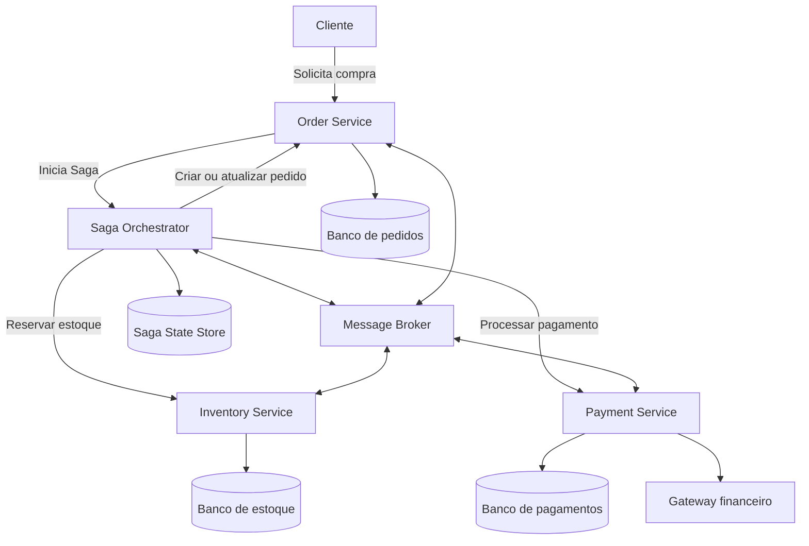

# Visão Geral da Arquitetura Saga — E-commerce

## 1. Objetivo

Representar a arquitetura distribuída de um sistema de comércio eletrônico que utiliza microsserviços e o padrão Saga por orquestração para coordenar uma compra.

## 2. Componentes

- **Cliente:** inicia a solicitação de compra.
- **Order Service:** cria, consulta e cancela pedidos.
- **Saga Orchestrator:** coordena as etapas da transação e controla seu estado.
- **Inventory Service:** verifica disponibilidade e reserva ou libera produtos.
- **Payment Service:** solicita o processamento do pagamento por um gateway financeiro.
- **Message Broker:** transporta mensagens e eventos assíncronos entre os componentes, quando necessário.
- **Bancos de dados independentes:** cada microsserviço mantém seus próprios dados.
- **Saga State Store:** armazena o estado da Saga, as etapas executadas e as tentativas de processamento.

## 3. Diagrama de arquitetura

## 4. Responsabilidades

O orquestrador controla a sequência das etapas, registra os resultados e decide quando executar transações compensatórias.

Em caso de recusa do pagamento, a Saga solicita a liberação do estoque e o cancelamento do pedido. Em caso de sucesso, o pedido é confirmado.

## 5. Consistência e resiliência

A arquitetura adota consistência eventual, operações idempotentes, identificadores únicos de mensagens, retentativas controladas e tratamento de mensagens em dead-letter queue (DLQ).

Cada serviço é responsável pela integridade dos próprios dados.
