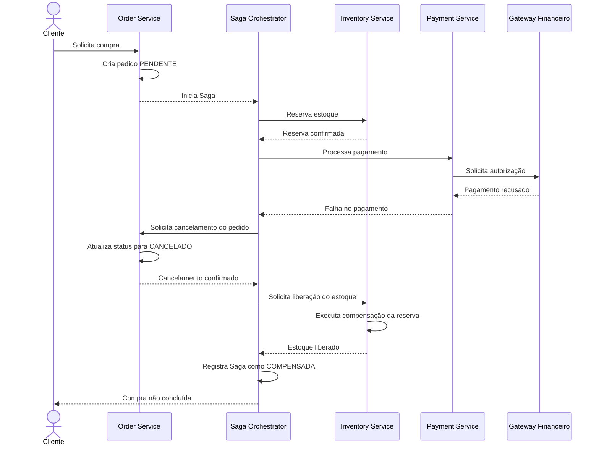

# Diagrama de Sequência — Falha e Compensação da Saga

## Objetivo

Demonstrar como o sistema trata a recusa do pagamento depois da reserva do estoque, executando transações compensatórias para manter a consistência dos dados.

## Fluxo de falha e compensação

## Estratégia de compensação

- **Cancel Order:** o pedido é marcado como cancelado.
- **Release Stock:** a reserva de estoque é desfeita, disponibilizando novamente os produtos.
- **Registro da Saga:** o orquestrador persiste o resultado da compensação e permite acompanhar a operação.

## Tratamento de falhas

As compensações devem ser idempotentes e possuir retentativas controladas. Se uma compensação falhar temporariamente, o sistema mantém a Saga em estado de compensação pendente até conseguir concluir a operação ou encaminhá-la para análise operacional.
