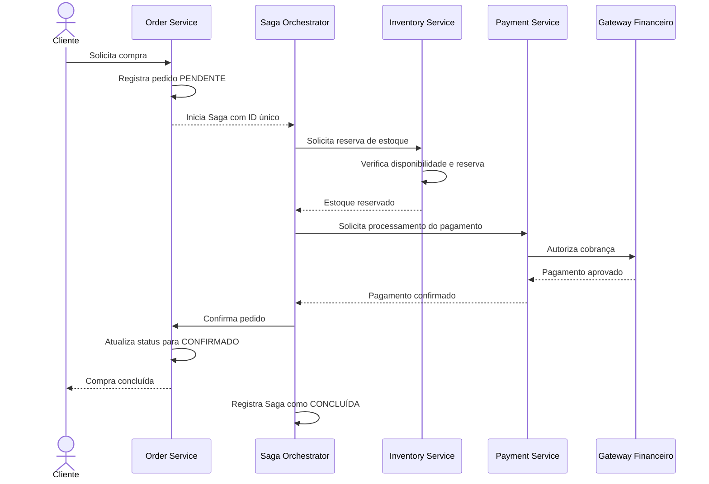

# Diagrama de Sequência — Compra com Sucesso

## Objetivo

Representar a sequência de comunicação entre os microsserviços quando uma compra é concluída com sucesso.

## Fluxo de sucesso

## Resultado esperado

O estoque fica reservado, o pagamento é aprovado e o pedido é confirmado. Cada etapa deve ser idempotente, evitando efeitos duplicados em caso de reenvio de mensagens.
